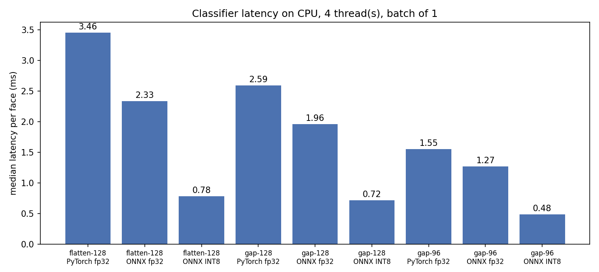
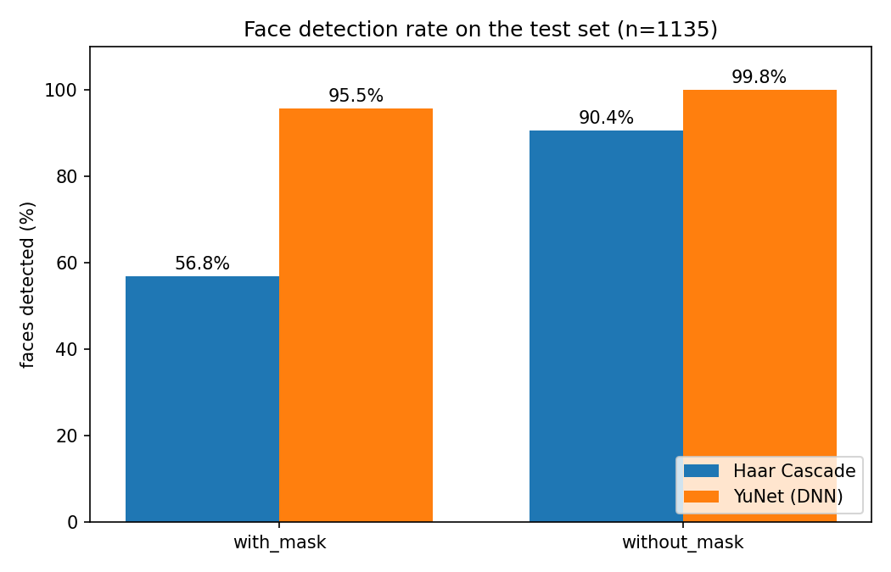

# Real-Time Face Mask Detection Using OpenCV and PyTorch

## 1. Project Title

**Real-Time Face Mask Detection Using OpenCV and PyTorch**, optimized and
exported for CPU-only edge deployment (ONNX, INT8).

## 2. Project Overview

This project detects faces from a live camera feed (or from a still
image) and classifies each detected face as either **`with_mask`**
or **`without_mask`**. It is built as a **two-stage pipeline**:

1. **OpenCV** finds where the faces are in each frame.
2. A custom **PyTorch CNN** classifier trained from scratch decides,
   for each face, whether the person is wearing a mask.

The result is a real-time application that draws a colored bounding
box and a label such as `with_mask 96.4%` around every face it sees.

The classifier was then redesigned and quantized for edge devices: the
deployed model is a **0.42 MB INT8 ONNX file** that runs with ONNX
Runtime, OpenCV and NumPy only, with no PyTorch needed on the device.

## 3. System Pipeline

```
Camera frame
    -> OpenCV DNN face detector (YuNet)
    -> face bounding box
    -> crop face region
    -> resize to 128x128 + normalize
    -> PyTorch CNN classifier (MaskCNN)
    -> with_mask / without_mask prediction + confidence
    -> display bounding box, label, and probability
```

The two stages are **independent**. OpenCV handles localization
("where is the face?") and the CNN handles classification ("what is
this face wearing?").

## 4. Results

All numbers below were measured on an **Apple M1 CPU limited to 4
threads**, to approximate a 4-core edge board. They are not
measurements on an edge device. Test accuracy is on the 1,135 held-out
test images.

### Edge optimization

| Model | Format | Size | Parameters | Test accuracy | Latency per face (median) | End-to-end FPS |
|---|---|---|---|---|---|---|
| Original MaskCNN | PyTorch fp32 | 18.35 MB | 4.58 M | 97.97% | 3.46 ms | 61.3 |
| Compact MaskCNN, 128×128 | ONNX INT8 | **0.42 MB** | 0.39 M | **98.06%** | **0.72 ms** | **99.9** |
| Compact MaskCNN, 96×96 | ONNX INT8 | 0.42 MB | 0.39 M | 97.27% | 0.48 ms | 107.1 |

- **44× smaller model** (18.35 MB → 0.42 MB) with no accuracy loss.
  Replacing the 4.2M-parameter fully connected layer with global average
  pooling cut parameters 11.8×, and INT8 quantization cut the file a
  further 3.8×.
- **4.8× lower classifier latency** (3.46 ms → 0.72 ms per face), and
  **1.6× higher end-to-end FPS** (61 → 100). With 1 CPU thread the
  latency gain is 2.5× (4.75 ms → 1.87 ms).
- **INT8 quantization cost 0 accuracy points** on all three model
  variants, and every fp32 ONNX export matches the PyTorch predictions
  on 100% of test images.
- After optimization the pipeline is limited by face detection, not
  classification: YuNet takes about 7.2 ms of the ~10 ms per frame.

End-to-end FPS covers detection, cropping, preprocessing, classification
and drawing over 300 synthetic 640×480 frames with 1–3 real test faces
each (camera capture and display excluded). Full results for every
variant, backend and thread count are in
[`results/benchmark.md`](results/benchmark.md).



### Face detection on masked faces

| Detector | Masked faces found (n=560) | Unmasked faces found (n=575) | Time per image |
|---|---|---|---|
| Haar Cascade | 56.8% | 90.4% | 13.4 ms |
| YuNet (DNN) | **95.5%** | **99.8%** | **6.0 ms** |

Haar Cascade misses many masked faces because a mask hides the mouth and
chin features it relies on. Switching to YuNet raised the masked-face
detection rate from 56.8% to 95.5% while also being faster.



### Classifier evaluation

| Model | Accuracy | Macro F1 |
|---|---|---|
| Original MaskCNN (128×128) | 97.97% | 0.980 |
| Compact MaskCNN (128×128) | 98.06% | 0.981 |
| Compact MaskCNN (96×96) | 97.80% | 0.978 |

These come from `evaluate.py`, which resizes with PIL as in training.
The benchmark resizes with OpenCV as an edge device would, which gives
the same accuracy at 128×128 and 97.27% at 96×96.

## 5. Quick Start

```bash
pip install -r requirements.txt
python src/prepare_data.py                      # split raw_data/ into data/
python src/train.py --head gap                  # train the compact model
python src/evaluate.py --model_path models/mask_classifier_gap.pth
```

Live camera with the edge model (ONNX Runtime on CPU):

```bash
python src/live_camera.py --backend onnx --onnx_path models/mask_classifier_gap_int8.onnx --threads 4
```

Press `q` to quit. Add `--camera 1` if the wrong camera opens.

## 6. Edge Export and Benchmarking

```bash
# Export to ONNX, check parity with PyTorch, and write an INT8 copy
python src/export_onnx.py --model_path models/mask_classifier_gap.pth --quantize

# Benchmark every model in models/ (writes results/benchmark.*)
python src/benchmark.py

# Benchmark on a recorded webcam clip instead of synthetic frames
python src/benchmark.py --video my_clip.mp4

# Compare Haar Cascade and YuNet on the test set
python src/compare_detectors.py
```

See [`docs/phase_9_edge_deployment.md`](docs/phase_9_edge_deployment.md)
for how each step works.
